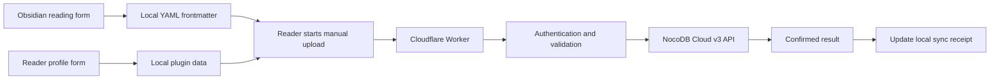

# Tbpedia Reading Analytics

## Detailed Design Specification — Phases 1 and 2

**Version:** 2.2  
**Date:** 17 October 2026  
**Status:** Implemented MVP; see the deployment addendum for verified resources  
**Product:** `tbpedia-analytics` Obsidian plugin and Cloudflare Worker  
**Scope:** Foundation, reader profiles, local reading capture and manual upload

## 1. Purpose and agreed scope

Build a simple, privacy-aware, offline-first reading tracker. A reader maintains reading information in Obsidian and can deliberately upload the current information to NocoDB. The profile includes demographic information needed for future analytics, while analytics implementation is deferred.

NocoDB Cloud is the proof-of-concept backend. The later self-hosted target is NocoDB Community Edition with SQLite. Cloud infrastructure is managed by NocoDB; choosing SQLite applies to the later self-hosted deployment. NocoDB documents a local SQLite fallback when no database connection is configured. [NocoDB environment variables](https://nocodb.com/docs/self-hosting/environment-variables)

### 1.1 Deliverables by phase

| Phase | Deliverable | Result |
|---|---|---|
| 1 — Foundation | NocoDB tables, content identifiers, reader provisioning, complete profile schema, gateway contracts and capability checks | A pilot reader can connect securely and maintain a profile including birth information, sex and organisation |
| 2 — Plugin MVP | Reading form, all 17 reading properties, safe frontmatter saving, local profile editing and manual synchronization | Reading data survives offline use and can be created or updated in NocoDB on request |

Basic authentication, validation and confirmation of manual writes belong to these two phases. They are necessary for a safe pilot and are not postponed.

### 1.2 Explicit boundaries

Included: one reader per vault, one active uploading installation per reader, administrator-assisted enrollment, profile editing, current reading state, manual upload, local detection of changes and clear error messages.

Deferred: automatic upload, background retries, durable event outboxes, event history, server revision counters, multi-device merging, download/restore of cloud reading data, dashboards, demographic analysis, aggregates, recommendations, normalized label tables, Cloudflare KV and cloud queues. The actual Community Edition migration is also deferred.

Local saving works without enrollment or connectivity. Only cloud features require a reader credential and consent. Ordinary synchronization uploads current state; it does not replay reading actions or provide full historical auditability.

### 1.3 Product defaults

These are implementation defaults rather than additional user requirements: demographic fields are optional; enrollment is assisted by an administrator; the first acceptance platform is Obsidian Desktop; there is one active uploader per reader; synchronization is manual. Reuse portable Obsidian APIs so mobile support can be evaluated separately.

## 2. Architecture and data ownership



| Data | Editing authority | Cloud copy |
|---|---|---|
| Published content and catalogue IDs | Tbpedia content administrator | `content_items` |
| Personal reading fields | Reader's local frontmatter | Current snapshot in `reading_records` |
| Profile fields | Reader's profile form after enrollment | `readers` |
| Account status and credential hash | Administrator/server | Restricted fields in `readers` |
| Last confirmed upload fingerprint | Plugin bookkeeping | Matching fingerprint on the cloud reading row |

There are three application tables. References between them are stable text identifiers validated by the Worker. NocoDB relationship fields are optional conveniences and are not required for the MVP to work.

The cloud reading copy is not a bidirectional editing surface. Administrators should avoid editing reading values directly. A later local upload would replace those values. An exceptional administrative correction must also be applied to the reader's local data.

## 3. Shared data conventions

| Item | Convention |
|---|---|
| Identifier storage | Ordinary single-line text, including UUID strings |
| Internal NocoDB row ID | Implementation detail; never the portable identity |
| Date-only values | `YYYY-MM-DD`, interpreted in the reader's local calendar |
| Timestamps | UTC ISO 8601 strings at the gateway boundary |
| Optional scalar values | JSON/YAML `null`; never zero as a substitute for missing data |
| Empty lists | `[]` |
| Reading status | Stable codes in cloud/API; Chinese display labels in frontmatter/UI |
| List storage | YAML arrays locally, JSON arrays in the gateway, serialized JSON in NocoDB long-text cells |
| Booleans and numbers | Actual boolean/numeric values; reject strings such as `"false"` or `"5"` at the gateway |
| Schema version | `1` for the profile and reading payloads in this document |

Use portable text identifiers rather than a platform-specific generated UUID field. Application-generated IDs must survive export/import. No PostgreSQL-specific column types, SQL functions, triggers or direct database access are required.

Example IDs such as `TBP-001-C01` illustrate the format only. The catalogue administrator must approve the real IDs before publishing notes.

## 4. Phase 1 — NocoDB foundation

### 4.1 Environment setup

Create a dedicated proof-of-concept base containing `readers`, `content_items` and `reading_records`. Use synthetic records for initial verification. Actual contact and demographic data is entered only after the reader has accepted the profile notice.

Use the cloud plan's actual record and API allowances when selecting pilot size; do not assume a published plan name guarantees a particular capacity. This specification makes no million-record performance commitment.

The application owns the fields listed below. Existing unrelated tables and data must not be changed during implementation. Do not expose public views of profiles, credentials or individual reading habits.

### 4.2 Table: `readers`

One row represents one enrolled reader. All lengths and option lists below are product validation rules enforced by the gateway, even if NocoDB does not enforce them itself.

| Field | NocoDB field type | Required/default | Rule and purpose |
|---|---|---|---|
| `reader_id` | Single line text | Required | UUID generated once by the provisioning tool; immutable |
| `nickname` | Single line text | Required | Trimmed; 1–100 characters; need not be unique |
| `email` | Email | Optional/null | At most 254 characters; contact only; no verification |
| `birth_year` | Number, integer | Optional/null | 1900 through the current year; year only |
| `birth_month` | Number, integer | Optional/null | 1–12; allowed only when birth year is present |
| `sex` | Single select | `PREFER_NOT_TO_SAY` | `FEMALE`, `MALE`, `OTHER`, `PREFER_NOT_TO_SAY` |
| `country_code` | Single line text | Optional/null | Uppercase ISO 3166-1 alpha-2 code from a bundled country list |
| `reader_type` | Single select | Optional/null | Reader's personal category; options below |
| `organisation` | Single line text | Optional/null | Trimmed; at most 200 characters; Unicode permitted |
| `sync_token_hash` | Single line text | Required | SHA-256 digest of the random reader token; never returned to the plugin |
| `account_status` | Single select | `ACTIVE` | `ACTIVE` or `DISABLED`; administrator-controlled |
| `cloud_sync_enabled` | Checkbox | false | Server permission for reading uploads |
| `profile_consent_version` | Single line text | Optional initially | Accepted profile notice version |
| `profile_consent_at` | DateTime | Optional initially | Server timestamp when profile consent is accepted |
| `reading_consent_version` | Single line text | Optional initially | Notice covering cloud reading uploads, including reflections |
| `reading_consent_at` | DateTime | Optional initially | Server timestamp of most recent acceptance |
| `created_at` | DateTime | Required | Server/provisioning timestamp; never changed by profile editing |
| `updated_at` | DateTime | Required | Server timestamp of most recent profile/account update |
| `schema_version` | Number, integer | 1 | Profile schema version |

Provisioning can create the row before profile consent using only the nickname supplied for enrollment, identifiers and account-control fields. Demographic and contact fields remain empty until the profile is submitted with consent. A profile without recorded consent cannot upload reading records.

The birth-year lower bound is a pilot input rule and can be widened if a participant needs it. No day of birth is collected. Do not persist age or age group; derive these later, with the appropriate reference date. A year/month pair does not establish an exact birthday.

Sex is self-reported. Organisation is one optional free-text affiliation, not a directory relationship. Preserve its display spelling; trim surrounding whitespace. Organisation normalization for reporting is deferred.

| Reader-type code | Chinese label |
|---|---|
| `GENERAL` | 一般讀者 |
| `NEW_REFUGE` | 初皈依者 |
| `BUDDHIST_STUDENT` | 學佛者 |
| `PRACTITIONER` | 修行者 |
| `TBS_PRACTITIONER` | 真佛行者 |

The profile's `reader_type` describes the person. `reading_records.my_reader_types` describes the audience the person recommends for a particular item. They must not overwrite or automatically populate each other.

### 4.3 Table: `content_items`

| Field | NocoDB field type | Required/default | Rule and purpose |
|---|---|---|---|
| `content_id` | Single line text | Required | Immutable canonical ID; 1–80 ASCII letters, digits, hyphens or underscores |
| `content_type` | Single select | Required | `BOOK`, `CHAPTER` or `ARTICLE` |
| `parent_content_id` | Single line text | Optional/null | Existing parent catalogue ID; no self-parenting |
| `book_number` | Number, integer | Optional/null | Positive integer where applicable |
| `book_title` | Single line text | Optional/null | At most 255 characters |
| `chapter_number` | Number, integer | Optional/null | Zero or positive integer; zero supports prefaces |
| `chapter_title` | Single line text | Optional/null | At most 255 characters |
| `is_active` | Checkbox | true | Permits new reading uploads |
| `created_at` | DateTime | Required | Server/import timestamp |
| `updated_at` | DateTime | Required | Server/import timestamp |

At least one of `book_title` or `chapter_title` must be populated. Validate parent references when importing catalogue data. An ID is never reassigned to different content. Retire an entry using `is_active` rather than reusing its ID.

Catalogue import is administrator-only and runs after a duplicate-ID check. The plugin cannot create arbitrary catalogue entries. A file rename, move or title correction keeps its existing `tbpedia_content_id`. Detect repeated IDs within a vault and stop upload for those notes until the ambiguity is resolved.

### 4.4 Table: `reading_records`

One row represents the latest saved cloud snapshot for a reader and content item. Use the 17 reading columns in section 9, plus these technical fields:

| Field | NocoDB field type | Required/default | Rule and purpose |
|---|---|---|---|
| `reader_id` | Single line text | Required | Derived from authentication; references `readers.reader_id` |
| `content_id` | Single line text | Required | References `content_items.content_id` |
| `client_updated_at` | DateTime | Required | Best-effort local change/detection time; never used for conflict resolution |
| `synced_at` | DateTime | Required | Server time of the latest confirmed upload |
| `snapshot_hash` | Single line text | Required | Server-calculated SHA-256 of canonical reading values |
| `schema_version` | Number, integer | 1 | Reading schema version |

The logical key is `(reader_id, content_id)`. Keep reader demographics only in `readers`; do not copy birth information, sex or organisation into every reading row. Future reporting can join through `reader_id`.

Do not add an event table, event IDs, server revisions or per-action timestamps. The five reading dates store the latest occurrence of their respective statuses. Older occurrences are not retained by the MVP.

### 4.5 Uniqueness and edition compatibility

Configure physical uniqueness where the selected deployment supports it, but do not make paid-only field features a Community Edition dependency. NocoDB currently documents unique fields as a Cloud Business-and-above/licensed self-hosted feature. [NocoDB field capabilities](https://nocodb.com/docs/product/tables/fields)

The portable baseline is controlled catalogue/provisioning imports, one active uploader per reader, sequential client requests, native upsert and checks for duplicate logical keys. A preliminary lookup is not an atomic lock. This pilot does not claim protection against simultaneous independent writers or exactly-once execution.

If a lookup finds more than one matching reader, content item or reading row, stop that operation and report `DUPLICATE_KEY`. Do not silently choose a row. Repair duplicates through an administrator. Database-level uniqueness and stronger writer coordination must be reconsidered before lifting the single-uploader boundary.

### 4.6 Administrative views

Provide three private grid views: reader profiles, catalogue, and current reading records. A fourth view of the same reading table may filter recently uploaded records for manual verification. These are operational views, not analytics dashboards.

Keep administrative access limited. Hiding a credential-hash column in a view is not a security boundary. The gateway must explicitly select and return only permitted profile fields.

## 5. Phase 1 — Reader provisioning and credentials

### 5.1 Enrollment workflow

1. The administrator enrolls a consenting pilot participant with their chosen nickname.
2. A local provisioning utility generates a UUID `reader_id` and a cryptographically random 32-byte reader token.
3. Store the token's SHA-256 hash in `readers`, with `ACTIVE` status and cloud reading uploads disabled.
4. Display the raw token once and provide it privately to the intended reader. Never publish it or place it in a URL.
5. The reader pastes it into plugin connection settings and selects **Test connection**.
6. The plugin calls `GET /v1/me`. A valid response binds the local profile and sync receipts to that `reader_id`.
7. The reader reviews their profile, saves it locally, accepts the profile notice and deliberately uploads it. Reading upload permission is enabled separately.

This is assisted enrollment, not a public registration API. The ordinary reader does not need a NocoDB account. NocoDB administrator authentication remains separate from reader enrollment.

No verification email, verification code, SMTP service, email-based identity matching or email-based recovery is required. Two readers may have the same contact email. Neither email nor nickname is an identity key.

### 5.2 Request authentication

The plugin sends `Authorization: Bearer <reader-token>` over HTTPS. The Worker bounds and validates the header, hashes the token, looks up the hash and requires exactly one active reader. It never accepts a client-supplied `reader_id` as authority.

Use a high-entropy token rather than a reader-chosen password. SHA-256 here protects a random token, not a human password. Do not log raw headers, tokens or token digests. Return a generic authentication failure for a missing, unknown or disabled credential.

The raw token is kept in memory by default and entered again after restarting Obsidian. An explicit **Remember token on this device** option may persist it in plugin data with a notice that the file is not encrypted and could be copied by vault-sync or backup tools. Exclude credentials from diagnostic exports and distributed vault packages. A native secure-store integration is optional, not a dependency of these phases.

An administrator revokes access by disabling the account or replacing its token hash. A replacement retains the same `reader_id`. Lost-token recovery is an assisted identity-confirmation process; entering an unverified email never authorizes recovery. Starting to use a different reader identity in an existing personal vault is blocked; use a separate vault or an explicit future migration tool.

## 6. Phase 1 — Gateway and profile API

### 6.1 Worker configuration

| Setting | Storage | Purpose |
|---|---|---|
| `NOCODB_URL` | Worker configuration | Approved NocoDB host |
| `NOCODB_BASE_ID` | Worker configuration | Proof-of-concept base |
| `READERS_TABLE_ID` | Worker configuration | Readers table |
| `CONTENT_TABLE_ID` | Worker configuration | Catalogue table |
| `READING_TABLE_ID` | Worker configuration | Reading table |
| `NOCODB_API_TOKEN` | Worker secret | Server-only NocoDB credential |
| `PROFILE_NOTICE_VERSION` | Worker configuration | Accepted profile notice version |
| `READING_NOTICE_VERSION` | Worker configuration | Accepted reading-upload notice version |

Store the NocoDB credential as a Worker secret; Cloudflare provides secret bindings for sensitive configuration. Do not commit it to source code or include it in plugin settings. [Cloudflare Worker secrets](https://developers.cloudflare.com/workers/configuration/secrets/)

Use the narrowest NocoDB service credential available for the selected edition and a dedicated base. The gateway always enforces reader ownership itself. Clients cannot choose NocoDB hosts, table IDs, merge fields or arbitrary query expressions.

### 6.2 Routes

| Method and path | Purpose | Phase |
|---|---|---|
| `GET /v1/me` | Test connection; return the authenticated reader's editable profile, cloud permission and current notice versions | 1 |
| `PATCH /v1/me` | Save the authenticated reader's profile and reading-upload permission | 1 |
| `POST /v1/reading/sync` | Validate and upsert one complete reading snapshot | Contract in 1; implementation/integration in 2 |

All responses use JSON and `Cache-Control: no-store`. Server-generated `request_id` values correlate errors without logging personal payloads. Require JSON for write requests. Proposed product limits are 16 KiB per profile request, 128 KiB per reading request and one reading item per request; these are application choices, not advertised provider limits.

### 6.3 Profile form and local handling

The form contains nickname, optional email, birth year, birth month, sex, country, reader type and organisation. Sex defaults to **Prefer not to say**; all other demographic values start empty. Country selection uses the bundled country list. Include **Save locally**, **Save and upload profile**, and a separate cloud-reading permission control.

Save locally never contacts the server. Profile data remains outside individual notes. A first connection must not silently replace a locally edited profile with server values. Display a difference summary and let the reader explicitly choose the existing cloud profile or the local draft before uploading. Subsequent uploads send the complete editable profile, with `null` for cleared optional fields.

### 6.4 Profile write contract

```json
{
  "schema_version": 1,
  "profile": {
    "nickname": "蓮友",
    "email": null,
    "birth_year": 1975,
    "birth_month": 8,
    "sex": "PREFER_NOT_TO_SAY",
    "country_code": "MY",
    "reader_type": "BUDDHIST_STUDENT",
    "organisation": "示例讀書會"
  },
  "profile_notice_version": "profile-v1",
  "cloud_sync_enabled": true,
  "reading_notice_version": "reading-v1"
}
```

Notice-version strings are examples; deployment values must match the displayed notices. The gateway returns `428 CONSENT_REQUIRED` if required acceptance is absent or outdated. Server time records acceptance. Repeated profile saves under the same accepted notice do not reset its acceptance time. A newly accepted notice version or renewed reading consent updates the corresponding version/time. No consent-history table is introduced.

The Worker validates the entire request before updating the one existing reader row by its server-resolved NocoDB row ID. It must never upsert a profile from an arbitrary client identity or expose credential/account-control fields through this route. `cloud_sync_enabled: true` requires both accepted profile and reading notices. Disabling it retains the last acceptance metadata for administrative context.

Successful response:

```json
{
  "reader_id": "8b73ca2e-44a7-4d6b-b5b9-1f3f2b8ea201",
  "profile_saved": true,
  "cloud_sync_enabled": true,
  "updated_at": "2026-10-17T08:30:00Z",
  "request_id": "example-request-id"
}
```

`GET /v1/me` returns the same reader's editable profile plus account permission, recorded consent versions and current required notice versions. It never returns token hashes, NocoDB row IDs, service tokens or other readers' data.

### 6.5 Consent and pausing uploads

The profile notice explains the identity/demographic fields and their intended future analysis. The reading notice explains that enabling cloud uploads includes ratings, classifications and personal reflections. Actual analytics use is deferred and must remain within the stated purpose and applicable user choices.

The local cloud-upload switch defaults off and blocks reading uploads immediately when turned off, even offline. **Apply to cloud** sends the updated server permission when connected; show **Cloud setting not yet updated** until confirmed. Turning it on and applying permission does not upload notes automatically. A separate manual synchronization action is required.

Pausing uploads does not delete existing cloud data. Provide a documented administrator-assisted process for requesting deletion of the reader profile and its reading rows. No automatic deletion API is included.

## 7. Phase 1 acceptance gate

Phase 1 is complete when:

1. All three tables and the full profile schema exist in a dedicated proof-of-concept base.
2. A synthetic reader can connect, upload a profile with birth year/month, sex and organisation, change those values and clear optional values.
3. Invalid birth month, future birth year, month without year and unsupported select values are rejected without changing stored data.
4. Email remains optional and no email verification is triggered by the application.
5. Credential revocation works, and profile responses omit secret fields.
6. Duplicate catalogue IDs and ambiguous reader-token matches are blocked.
7. The chosen NocoDB deployment passes the reading upsert compatibility checks in section 13 using synthetic records.
8. Exact table IDs, field names/types, option codes, notice versions and tested NocoDB API behavior are recorded in the implementation configuration.

The deployment addendum records the checks completed against the implemented MVP. Native Obsidian interface acceptance still requires reloading and using the installed plugin.

## 8. Phase 2 — Plugin structure and user interface

### 8.1 Modules

| Module | Responsibility |
|---|---|
| Settings and profile | Local profile draft, connection, consent and cloud-upload preference |
| Reading form | Display and validate the 17 reading fields for the active note |
| Frontmatter adapter | Read tracked keys and modify only those keys plus the local update timestamp |
| Data mapper | Chinese labels to API codes; typed defaults; list normalization |
| API client | Authenticated requests to the fixed Worker API; one request at a time |
| Sync receipts | Persist last confirmed upload hashes and display status |
| Manual sync controller | Scan selected folders on demand; upload changed notes sequentially |

Implement the plugin and Worker in TypeScript with shared schemas and mapping constants. A small validation library is acceptable, but a large application framework is unnecessary. Pin dependency versions in the lockfile.

### 8.2 Settings layout

| Area | Controls |
|---|---|
| Connection | Approved Worker URL, masked reader-token input, optional remember-token control, Test connection |
| Reader profile | Nickname, email, birth year/month, sex, country, reader type, organisation |
| Privacy | Profile notice, reading-upload notice, local cloud permission and confirmed server permission |
| Reading scope | Folders to include when scanning for changed reading notes |
| Actions | Save profile locally, Save and upload profile, Sync changed notes |
| Status | Connected reader nickname, local profile upload state and last manual-sync summary |

If no folders are configured, **Sync changed notes** scans Markdown notes carrying `tbpedia_content_id`. Folder selection narrows that set. Never enroll every Markdown file as reading content automatically.

First connection must show the account identity returned by the server before enabling upload actions. Changing the gateway URL clears the connection binding and receipts for that target after a local explanation; it must not send an existing token to a new host automatically. Require the reader to deliberately connect to the new approved endpoint.

### 8.3 Reading form

Open the form for the active Markdown note through a command or ribbon action. Show the note title and content ID, followed by:

1. Reading progress: planned reading, status, depth and count.
2. Reading dates: wanted, started, completed, declined and abandoned dates.
3. Reflection and evaluation: reflection, recommendation and rating.
4. Personal classification: keywords, recommended reader types, Buddhist level, practice level and subtopics.

Provide **Save locally**, **Save and sync**, and **Cancel**. Save and sync is available only when connected and both local/server reading-upload permission is enabled. Failure of the network part must not undo a successful local save.

Opening and cancelling the form never changes a note. Show inline field errors. Disable repeated submission while saving. Before committing, re-read the tracked frontmatter; if it differs from the values loaded into the form, ask the reader to reload rather than overwrite intervening edits. This is a local edit check, not a distributed conflict algorithm.

### 8.4 Commands

| Command | Behaviour |
|---|---|
| Open reading form | Edit the active note |
| Mark as reading | Set status to 在讀 and update its latest start date |
| Mark as completed | Apply the completion rules in section 10 |
| Start rereading | Set status to 在讀; retain completed-read count |
| Sync this note | Save no additional reading changes; upload its validated current snapshot |
| Sync changed notes | On demand, scan eligible notes and upload changed snapshots |

Quick actions save locally only. The reader separately starts synchronization, or uses Save and sync in the form.

## 9. Phase 2 — Reading fields and normalization

### 9.1 Full 17-field contract

| No. | Frontmatter key | API / NocoDB column | NocoDB type | Default and validation |
|---|---|---|---|---|
| 1 | 計劃閱讀 | `planned_reading` | Checkbox | false; boolean |
| 2 | 閱讀狀態 | `reading_status` | Single select | `UNREAD`; approved status code |
| 3 | 閱讀層次 | `reading_depth` | Single select | null; approved depth code |
| 4 | 閱讀次數 | `reading_count` | Number, integer | 0; integer from 0 through 2,147,483,647 |
| 5 | 想讀日期 | `want_to_read_date` | Date | null; valid calendar date |
| 6 | 在讀日期 | `reading_start_date` | Date | null; valid calendar date |
| 7 | 已讀日期 | `completed_date` | Date | null; valid calendar date |
| 8 | 不讀日期 | `not_reading_date` | Date | null; valid calendar date |
| 9 | 棄讀日期 | `abandoned_date` | Date | null; valid calendar date |
| 10 | 閱讀感想 | `reading_reflection` | Long text | null; up to 10,000 Unicode characters; preserve line breaks |
| 11 | 我的閱讀推薦 | `my_recommendation` | Single select | null; `RECOMMEND`, `NOT_RECOMMEND`, `UNDECIDED` |
| 12 | 我的評分 | `my_rating` | Number, integer | null; integer 1–5 |
| 13 | 我的關鍵詞 | `my_keywords` | Long text | `[]`; JSON-serialized array |
| 14 | 我的讀者類型 | `my_reader_types` | Long text | `[]`; JSON-serialized array of reader-type codes |
| 15 | 我的佛學級別 | `my_buddhist_level` | Number, integer | null; integer 0–3 |
| 16 | 我的修行級別 | `my_practice_level` | Number, integer | null; integer 0–3 |
| 17 | 我的子主題 | `my_subtopics` | Long text | `[]`; JSON-serialized array |

Limits above are pilot product limits. The form and gateway share them. Missing keys normalize to the defaults when a snapshot is created. Explicit `null` is allowed only for nullable fields. Wrong existing types are reported rather than silently converted. A note with a scalar keyword value must be corrected to a YAML list before upload.

### 9.2 Display mappings

| Chinese status | API code | Associated date |
|---|---|---|
| 還沒閱讀 | `UNREAD` | None |
| 想讀 | `WANT_TO_READ` | `want_to_read_date` |
| 在讀 | `READING` | `reading_start_date` |
| 已讀 | `COMPLETED` | `completed_date` |
| 不讀 | `NOT_READING` | `not_reading_date` |
| 棄讀 | `ABANDONED` | `abandoned_date` |

| Reading depth label | API code |
|---|---|
| 略讀 | `SKIM` |
| 通讀 | `FULL` |
| 精讀 | `CLOSE` |
| 深入研讀 | `STUDY` |
| 基礎閱讀 | `BASIC` |
| 檢視閱讀 | `INSPECTIONAL` |
| 分析閱讀 | `ANALYTICAL` |
| 主題閱讀 | `SYNTOPICAL` |

The last four depth choices preserve the sample vault's reading vocabulary. They remain distinct from the first four choices rather than being assigned an inaccurate equivalent.

Recommendation mappings are 推薦 → `RECOMMEND`, 不推薦 → `NOT_RECOMMEND`, 未決定 → `UNDECIDED`. A missing recommendation is null; it differs from an explicit 未決定 selection.

The reader-type labels and codes use the profile vocabulary in section 4.2. Here multiple values are allowed because the field describes recommended audiences. Buddhist/practice levels classify the content from the reader's perspective; do not infer a person's attainment or profile category from them. Display each level as 0, 1, 2 or 3 until Tbpedia supplies approved explanatory labels.

### 9.3 Lists and empty values

For keyword/subtopic arrays: allow up to 50 values, each 1–100 characters after trimming; remove exact duplicates while preserving order. Preserve Chinese text and punctuation. Recommended reader-type lists contain only the five approved codes without duplicates.

At the gateway boundary these are real arrays. Before writing NocoDB, serialize them with `JSON.stringify`. A cloud keyword cell therefore contains text such as `["空性","無我"]`. Do not use comma-separated text, a paid field type or linked label records.

All 17 fields must be present in an upload. Clear nullable fields with null; clear list cells with the serialized empty array `[]`; preserve false and zero as meaningful values. Never omit a field merely because it was cleared locally. The implementation must verify how the selected deployment stores and returns empty values before accepting the pilot.

## 10. Phase 2 — Reading actions and dates

### 10.1 Status transitions

Changing status through the form or a quick action updates the corresponding date to today's local calendar date. A date explicitly entered in the same form takes precedence. Retain dates for other statuses; each is the latest known occurrence, not an event history. Changing to UNREAD creates no date.

`planned_reading` is independent of status and is not silently reset by completion or abandonment. Rating, reflection and classifications survive every status change.

### 10.2 Completion and rereading

Reading count means completed readings:

- Moving from a different status to COMPLETED increments the existing count once, unless the reader explicitly supplied a corrected count in the form.
- Marking an already-completed note as completed again changes neither its count nor completion date. The action offers Start rereading instead.
- Start rereading sets READING and its start date; count remains unchanged until the next completion.
- Ordinary Save, Sync, resubmission and read-back never increment counts.
- Manual count correction is permitted and changes the stored absolute value.

For example, a completed note with count 2 becomes READING/count 2 on reread, then COMPLETED/count 3 on the next completion. Uploading this state three times still stores count 3.

Direct YAML edits are treated as the reader's explicit values. Synchronization does not invent dates or increment counts to reconstruct an action that it did not observe. It can flag unusual combinations for review, but should not manufacture history.

### 10.3 Date interpretation

Date-only fields are not converted to UTC timestamps. Validate real dates, including leap years. Do not require every retained status date to be ordered: after rereading starts, the prior completion date can legitimately precede the latest start date. Timestamps are synchronization metadata and do not replace the reader's calendar dates.

## 11. Phase 2 — Local files and safe saving

### 11.1 Frontmatter example

```yaml
---
書名: 淡煙集
冊數: 1
章號: 1
tbpedia_content_id: TBP-001-C01

計劃閱讀: true
閱讀狀態: 已讀
閱讀層次: 精讀
閱讀次數: 2

想讀日期: "2026-10-01"
在讀日期: "2026-10-10"
已讀日期: "2026-10-17"
不讀日期: null
棄讀日期: null

閱讀感想: >-
  對本文的教導有更深入的理解。

我的閱讀推薦: 推薦
我的評分: 5
我的關鍵詞:
  - 空性
  - 無我
我的讀者類型:
  - 學佛者
  - 修行者
我的佛學級別: 2
我的修行級別: 2
我的子主題:
  - 般若智慧

tbpedia_reading_updated_at: "2026-10-17T08:30:00Z"
---
```

The example metadata and catalogue ID are illustrative. Do not duplicate profile data or credentials into notes. No `event_id`, server revision or NocoDB row ID belongs in frontmatter.

### 11.2 Safe-write rules

Use `app.fileManager.processFrontMatter()` to modify the supported reading keys and the local update timestamp. Obsidian's official API supplies this frontmatter mutation mechanism. [Official Obsidian API](https://github.com/obsidianmd/obsidian-api/blob/master/obsidian.d.ts)

Preserve all unrelated property values and the note body. Do not replace the entire YAML block using a hand-built string. YAML formatting, quoting and comments are not guaranteed to remain byte-identical; acceptance focuses on unchanged property values and note content.

If YAML is invalid, the note is read-only, or tracked values changed while the form was open, stop with a useful error. Do not overwrite the file. Upload only after the local save succeeds. If a note has no catalogue ID, local saving is allowed, but upload is blocked until an administrator-supplied ID is assigned. Never generate a new content ID from a filename.

### 11.3 Local plugin data

Persist the following through supported plugin storage:

| Data | Purpose |
|---|---|
| Local profile draft and last confirmed profile fingerprint | Offline editing and profile upload status |
| Approved gateway URL and bound reader ID | Connection identity |
| Local cloud-upload preference and accepted notice versions | Permission checks |
| Folder selection | On-demand reading scan scope |
| Sync receipts | Last confirmed hash/time for each reader/content/target combination |
| Reader token | Only if the explicit remember-token option is enabled |

Do not duplicate reflection payloads in sync receipts. Receipts contain identifiers, hashes and timestamps only. Plugin data files contain personal information and are not inherently encrypted. Exclude them from published Tbpedia distributions; ensure vault backup/sync choices are explained. This specification does not claim OS-level isolation from other installed plugins or local users.

### 11.4 Detecting changed notes without an event outbox

Each manual scan reads the tracked frontmatter of eligible notes and computes a fingerprint. A missing receipt or different fingerprint means **Pending upload**. Receipts are keyed by gateway target, reader ID and content ID, so one target's receipt cannot mark another target's data synchronized.

Hash the UTF-8 JSON serialization of `{schema_version, content_id, values}`. Write object keys in that order; write the 17 `values` keys in section 9.1 order; use normalized codes, typed values, explicit nulls and normalized lists. Exclude timestamps, paths and unrelated frontmatter. Use the same canonicalization code in the plugin and Worker.

The Worker independently computes the hash; it does not trust a client digest. Store that digest as `snapshot_hash`. After a confirmed upload, persist it as the receipt. Reordering list values is treated as a change because list order is preserved.

After a restart, the reader can scan again to find changes. There is no autonomous uploader or durable per-action outbox. If a note was saved before a receipt write failed, it will be offered for re-upload, which is safe for an absolute-state snapshot under the supported single-uploader workflow.

## 12. Phase 2 — Manual synchronization contract

### 12.1 Preconditions

Before uploading, require a connected active reader, current profile consent, current reading consent, local permission on, server permission on, a valid and active catalogue item, valid reading values and no duplicate content IDs in the selected vault scope. For Sync this note, also check for duplicate copies of that content ID in the vault.

Run one upload at a time. Disable overlapping sync commands. Scan changed notes on demand and submit each note independently. Do not send a multi-table transaction or increment operation.

### 12.2 Plugin-to-Worker request

`POST /v1/reading/sync` uses the bearer reader token. It submits one complete snapshot:

```json
{
  "schema_version": 1,
  "content_id": "TBP-001-C01",
  "client_updated_at": "2026-10-17T08:30:00Z",
  "values": {
    "planned_reading": true,
    "reading_status": "COMPLETED",
    "reading_depth": "CLOSE",
    "reading_count": 2,
    "want_to_read_date": "2026-10-01",
    "reading_start_date": "2026-10-10",
    "completed_date": "2026-10-17",
    "not_reading_date": null,
    "abandoned_date": null,
    "reading_reflection": "對本文的教導有更深入的理解。",
    "my_recommendation": "RECOMMEND",
    "my_rating": 5,
    "my_keywords": ["空性", "無我"],
    "my_reader_types": ["BUDDHIST_STUDENT", "PRACTITIONER"],
    "my_buddhist_level": 2,
    "my_practice_level": 2,
    "my_subtopics": ["般若智慧"]
  }
}
```

For form saves, use the local update timestamp. When direct edits cannot be associated reliably with that timestamp, use the scan/detection time. `client_updated_at` is descriptive only and is neither an ordering guarantee nor a conflict-resolution rule.

Reject unknown request fields, unsupported schema versions and incorrect types. The request must not contain profile demographics, a reader ID, a NocoDB credential, full Markdown text or local paths.

### 12.3 Worker processing

1. Authenticate the token and load the reader's account and permission state.
2. Validate consent, JSON shape, field values and payload size.
3. Verify exactly one active matching content item.
4. Check for an ambiguous existing reader/content match; return a repairable error if there are duplicates.
5. Map values to fixed NocoDB columns, serialize the three arrays, calculate the fingerprint and add server-managed identity/time fields.
6. Call native NocoDB upsert, matching on `reader_id` and `content_id`.
7. Inspect the result, read the resulting row back and compare all 17 normalized values with the requested snapshot, including cleared values and arrays. Comparing the stored hash alone is insufficient.
8. Return success only when the saved values are confirmed. Do not start background work after replying.

Read-back comparison normalizes equivalent backend representations of null/empty optional scalar cells, date-only values, booleans and serialized arrays. Define these conversions once and cover them in compatibility tests; never use broad truthiness conversion that would turn zero or false into missing data.

### 12.4 NocoDB adapter

Use the current v3 Data API. Its dedicated upsert route matches existing rows or inserts a new row. Updates use the records PATCH route; the gateway uses that route for an existing profile. [NocoDB v3 Data API](https://nocodb.com/apis/v3/data)

```http
POST {NOCODB_URL}/api/v3/data/{baseId}/{readingTableId}/records/upsert
xc-token: <server-only NocoDB credential>
Content-Type: application/json
```

Envelope after server authentication and mapping; the short example illustrates structure only. Production `fields` includes every reading column and technical field:

```json
{
  "fieldsToMergeOn": ["reader_id", "content_id"],
  "records": [
    {
      "fields": {
        "reader_id": "8b73ca2e-44a7-4d6b-b5b9-1f3f2b8ea201",
        "content_id": "TBP-001-C01",
        "reading_status": "COMPLETED",
        "reading_count": 2,
        "my_keywords": "[\"空性\",\"無我\"]"
      }
    }
  ]
}
```

The adapter owns base/table IDs, column mappings, API error translation and read-back conversion. It does not depend on internal NocoDB row IDs remaining the same after migration. Freeze application field names; if an administrator renames them, update and re-verify the adapter before allowing writes.

Native upsert does not supply application consent checks, reader authorization, snapshot validation or a cross-request lock. These remain explicit responsibilities or limitations of this design.

### 12.5 Success and client acknowledgement

```json
{
  "content_id": "TBP-001-C01",
  "status": "saved",
  "snapshot_hash": "<64-character SHA-256 hex digest>",
  "synced_at": "2026-10-17T08:31:00Z",
  "request_id": "example-request-id"
}
```

The digest above is a format marker, not a computed example. Before accepting it, the plugin verifies that it equals the hash of the submitted normalized snapshot. Then persist the receipt. Recompute the note's current hash: if the reader changed the note during upload, its status remains Pending upload. Do not mark a newer local edit synchronized based on an older response.

If saving the receipt fails after the cloud write, show **Cloud saved; local sync receipt could not be saved**. Keep the local data and allow the next manual scan to offer a safe resend.

### 12.6 Manual batch behaviour

Sync changed notes shows eligible, unchanged, invalid and pending counts before upload. Submit valid changed notes sequentially. For a local validation error, skip that note and continue with other valid notes. On authentication/permission failure, rate limiting or a backend/network failure, stop remaining network requests and display what still needs upload. Do not schedule retries automatically.

At completion show counts such as **8 saved, 2 unchanged, 1 invalid, 3 not attempted** and identify affected local notes. The reader can correct errors and run the command again. Do not call this a queued or guaranteed-delivery system.

## 13. Phase 2 — Errors, status and compatibility checks

### 13.1 Error contract

```json
{
  "error": {
    "code": "VALIDATION_FAILED",
    "message": "One or more reading fields need correction.",
    "fields": [
      {"field": "my_rating", "reason": "Expected an integer from 1 to 5, or null."}
    ]
  },
  "request_id": "example-request-id"
}
```

Do not echo submitted reflections, profile data, raw upstream responses or credentials in errors.

| HTTP / application code | Meaning | Reader-facing behaviour |
|---|---|---|
| 400 / `BAD_REQUEST` | Malformed or unknown request fields | Show error; retain local data |
| 401 / `UNAUTHENTICATED` | Reader credential unavailable or invalid | Ask reader to reconnect; no repeated requests |
| 403 / `UPLOAD_DISABLED` | Reading cloud permission is off | Show permission state; save locally |
| 404 / `CONTENT_NOT_FOUND` | No matching catalogue item | Request catalogue correction |
| 409 / `DUPLICATE_KEY` | Ambiguous cloud identity/content/reading key | Stop affected operation; administrator repair |
| 413 / `PAYLOAD_TOO_LARGE` | Application size limit exceeded | Identify size problem; retain content |
| 422 / `VALIDATION_FAILED` | Invalid values or inactive content | Show field/item reason |
| 428 / `CONSENT_REQUIRED` | Required notice not accepted | Open the relevant notice and profile controls |
| 429 / `RATE_LIMITED` | Gateway/upstream rate limit | Stop manual run; show retry guidance |
| 502 / `BACKEND_ERROR` | NocoDB failed or saved values did not verify | Mark upload unconfirmed; manual retry available |
| 504 / `BACKEND_TIMEOUT` | Upstream completion uncertain | Keep pending; retry same current state manually |

A timed-out response can follow a successful backend write. The next upload sends the current absolute values using the same reader/content match; it does not generate a new reading action. Do not promise exactly-once delivery.

A delayed older write could also finish after a later request. Stop the manual run on an uncertain write; after the backend recovers, explicitly resend the latest local snapshot and verify it. The single-uploader rule reduces conflicts but does not guarantee ordering across timed-out requests. Strong cross-request ordering requires additional coordination outside these two phases.

### 13.2 Local status model

| Status | Definition |
|---|---|
| Local only | Cloud reading uploads disabled or no reader connection |
| Pending upload | Current snapshot has no matching confirmed receipt |
| Syncing | One explicit manual upload is in progress |
| Synced | Current local snapshot matches the last confirmed upload receipt |
| Error | Last attempt failed or cannot be confirmed; local information remains available |

Synced means confirmed at the recorded time, not continuously verified against the cloud. Clearing or changing data in NocoDB independently will not be detected by local receipts. **Sync this note** can force a current-state upload even when a matching receipt exists.

### 13.3 Required NocoDB compatibility tests

Run against a dedicated synthetic dataset in the selected Cloud base. Repeat before any future Community Edition cutover:

1. Create a reading row with all 17 fields and read it back.
2. Upsert changed values for the same reader/content pair and confirm one row remains.
3. Re-upload the identical snapshot several times; confirm count, dates and row count remain correct.
4. Clear every nullable field; verify both storage and adapter read-back.
5. Store false, zero and level zero without converting them to null.
6. Round-trip multiline Chinese text, quotes, punctuation and emoji.
7. Round-trip JSON arrays containing commas and quotation marks inside individual strings.
8. Create synthetic duplicate match rows through the test setup; verify the application reports ambiguity rather than selecting one.
9. Simulate a write followed by a lost response, then manually resend and verify the supported workflow recovers.
10. Confirm field mappings cannot silently drop values; deliberately misconfigure one field in a test adapter and require verification failure.

A failing compatibility check blocks that deployment from being marked ready. Record the tested NocoDB version/API behavior. Do not claim that any chosen Community Edition version has been validated merely because the Cloud API works.

## 14. Phase 2 acceptance criteria

| ID | Scenario | Required result |
|---|---|---|
| P2-01 | Save all 17 fields offline | Note saves with correct types; no network request |
| P2-02 | Restart after offline edits | Frontmatter survives; next manual scan detects changes |
| P2-03 | Profile demographics edited offline | Local draft survives and can later be uploaded explicitly |
| P2-04 | Save on a note with unrelated YAML and body | All unrelated values and body remain unchanged |
| P2-05 | Invalid YAML or concurrent local form edit | Safe refusal; no overwriting |
| P2-06 | First manual reading upload | One row for authenticated reader and content |
| P2-07 | Change rating, reflection, dates and lists | Same row is updated; no unrelated row changes |
| P2-08 | Clear fields | Old cloud values are cleared after verified upload |
| P2-09 | Save/sync an already-completed note repeatedly | Reading count and completion date do not increase |
| P2-10 | Reread and complete again | Exactly one deliberate additional completion is recorded locally |
| P2-11 | Edit while a request is in progress | Response acknowledges only submitted version; newer version remains pending |
| P2-12 | Network fails or response is lost | Local save remains; manual retry is possible |
| P2-13 | Wrong, revoked or missing token | No write; no identity leakage |
| P2-14 | Body includes a forged reader ID or table ID | Request rejected; authenticated ownership cannot be overridden |
| P2-15 | Cloud upload preference off | No reading request is sent; server also rejects disallowed requests |
| P2-16 | Missing, inactive or duplicate content IDs | Local reading remains; affected upload blocked |
| P2-17 | Direct valid YAML edits | Manual scan detects differences; explicit values are uploaded without invented actions |
| P2-18 | Notebook file renamed or moved | Same content ID updates the same cloud row |
| P2-19 | Credentials/profile privacy inspection | No credentials or demographics in note frontmatter, outgoing reading payload or diagnostic export |
| P2-20 | Manual run has mixed outcomes | Accurate per-note results; no false success for failed/unattempted notes |

Use focused integration tests for the gateway adapter and meaningful unit tests for field mapping, canonical hashes, date validation and completion rules. Acceptance fixtures should include synthetic profiles and notes; do not use actual demographic records as test fixtures.

## 15. Content updates, deletion and recovery boundaries

The Tbpedia content distribution/update process must preserve the 17 personal reading properties and `tbpedia_reading_updated_at` when it updates published metadata or note bodies. This is an integration requirement on the updater; the reading plugin cannot protect a note from an unrelated tool that blindly replaces its file. Verify the update workflow with a populated synthetic note before releasing that integration.

Deleting a local note does not delete its cloud reading row. Disabling uploads does not erase cloud records. Neither action should be interpreted as an automatic deletion request.

Retain ordinary vault backups for local recovery. The cloud snapshot is not a complete vault backup and these phases do not include cloud-to-vault restoration. If a cloud write fails, frontmatter remains the recoverable current state. If an administrator deletes cloud data, force re-upload explicitly; local receipt matching alone will not discover the deletion.

## 16. Implementation order and handover

| Order | Work item | Completion evidence |
|---|---|---|
| 1 | Shared field schema, vocabulary and canonicalization definitions | Reviewed contracts and sample fixtures |
| 2 | NocoDB three-table setup and catalogue import | Recorded table IDs/types and duplicate-free catalogue |
| 3 | Pilot reader provisioning utility | Synthetic account, token hash and revocation verification |
| 4 | Worker authentication and profile routes | Profile/demographic acceptance cases pass |
| 5 | Native upsert adapter and read-back verification | Compatibility cases pass in synthetic base |
| 6 | Plugin settings and local profile handling | Offline profile save and explicit upload work |
| 7 | Reading form and safe frontmatter adapter | All 17 fields and completion rules pass |
| 8 | Manual sync and receipts | First upload, update, clearing and resend cases pass |
| 9 | Pilot acceptance and operator notes | Phase 1 and 2 gates signed off |

Handover contains the plugin source/build, Worker source/configuration, shared schemas, provisioning/import utilities, synthetic fixtures, capability-test results and a brief operator guide. The guide covers enrollment, credential revocation, profile changes, duplicate repair, deletion requests and NocoDB export. Secrets are supplied outside source control.

For later SQLite deployment, retain portable field definitions and IDs, the field mapping and a sample export. Keep NocoDB host/base/table configuration server-side so a later backend move does not require changing note identities or the reading payload. No self-hosted installation or migration is part of the present work.

## 17. Technical references

The implementation requirements above are product decisions. These primary sources establish the vendor interfaces used by the design; edition/version compatibility still requires the stated tests.

- [NocoDB v3 Data API](https://nocodb.com/apis/v3/data): record operations and the native upsert envelope.
- [NocoDB environment variables](https://nocodb.com/docs/self-hosting/environment-variables): SQLite fallback and application data directory configuration.
- [NocoDB fields](https://nocodb.com/docs/product/tables/fields): field capabilities and unique-field edition restrictions.
- [Cloudflare Worker secrets](https://developers.cloudflare.com/workers/configuration/secrets/): server-side secret bindings.
- [Official Obsidian API definitions](https://github.com/obsidianmd/obsidian-api/blob/master/obsidian.d.ts): frontmatter mutation and plugin APIs.

## 18. MVP deployment addendum — 17 October 2026

The application name is `tbpedia-analytics` for the Obsidian plugin, Cloudflare Worker and new NocoDB project.

| Resource | Implemented value |
|---|---|
| Worker API | `https://cfanalytics.tbpedia.org` |
| Health endpoint | `https://cfanalytics.tbpedia.org/health` |
| NocoDB base | `pwxyh62oc4wdhbg` |
| Readers table | `m0jtd86do2fo2vv` |
| Catalogue table | `m22h8q52rgo45i8` |
| Reading table | `mmphejly9cd41bk` |
| Source vault | `C:\Users\lotus\OneDrive - SJKC Yu Hua Kajang\Obsidian\AnalyticsV1` |
| MVP catalogue | 245 items: four books and 241 chapters |
| Initial cloud reading records | Zero; existing personal reading data was not uploaded |
| Initial pilot reader permission | Cloud reading uploads disabled |

Canonical content comes from `01 文集部` and `02 開示部`; duplicate and translated copies are excluded from the initial selection. IDs use `TBP-154-C00`-style identifiers for 文集部 and `TBS-640-C01`-style identifiers for 開示部. The catalogue bootstrap supports chapter zero for prefaces and the original legacy reading vocabulary. Publisher classifications remain separate from personal reading classifications.

Original note bytes were verified against backups after inserting only the stable-ID line. The plugin is installed in the sample vault and enabled for its next load. The NocoDB service credential is restricted to record operations in this project and stored as a Worker secret; it is never placed in the plugin.

Seventeen automated checks and eight live Worker/NocoDB checks passed, including demographic profile updates, native upsert, duplicate resend, Unicode/list round-trip, clearing values and permission enforcement. Synthetic records were removed. The native Obsidian interface was not driven interactively; reload the vault and follow the setup guide for reader enrollment/consent and manual use.

Implementation files, operational limits and startup instructions are in `outputs/tbpedia-analytics/README.md`. Deployment and test receipts are in that project's `reports/` folder.
